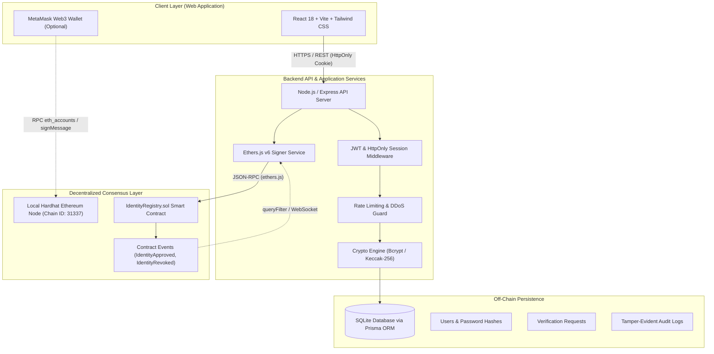

# ChainVerify — System Architecture & Cryptographic Design

## 1. System Overview

**ChainVerify** is a hybrid decentralized identity verification platform designed to demonstrate how blockchain technology integrates with traditional cybersecurity practices without violating user privacy.

The platform enforces a strict separation of concerns:
- **Authentication & Sensitive Storage**: Performed entirely off-chain using high-iteration salted hashing (Bcrypt / Argon2) and a relational database. Passwords, identity documents, and personal identifiable information (PII) are **never** published to the blockchain.
- **Tamper-Evident Attestation**: Managed on-chain using an Ethereum Solidity smart contract (`IdentityRegistry.sol`). The smart contract records only pseudonymous Decentralized Identifiers (DIDs) and cryptographic commitment hashes.

---

## 2. Architecture Diagram (Mermaid)

---

## 3. Cryptographic Data Flow

### A. User Registration Flow
1. User provides Full Name, Email, and Password over a validated HTTPS form.
2. The Backend validates inputs using Zod schemas and runs `bcrypt.hash(password, 12)`.
3. A pseudonymous Decentralized Identifier is generated:
   $$\text{DID} = \text{"did:chainverify:"} + \text{SHA256}(\text{Email} \parallel \text{Salt})[0..32]$$
4. An initial commitment hash is calculated:
   $$\text{Commitment} = \text{Keccak256}(\text{DID} \parallel \text{"INITIAL"} \parallel \text{Timestamp})$$
5. The backend stores the credentials in SQLite and submits an on-chain registration transaction to `IdentityRegistry.registerIdentity(did, commitment)`.

### B. User Authentication (Login) Flow
1. User submits Email and Password.
2. The server queries the off-chain database by email.
3. The password is verified using `bcrypt.compare`.
4. If invalid, a generic error message (*"Invalid email or password"*) is returned to prevent account enumeration attacks.
5. Upon success, a signed JWT is issued in an `HttpOnly`, `SameSite=Lax` cookie.

### C. Identity Verification Request Flow (Simulated Review)
1. Authenticated user selects a document type (e.g., `PASSPORT`) and inputs a masked document reference.
2. The backend generates a SHA-256 fingerprint of the document attributes:
   $$\text{DocumentHash} = \text{SHA256}(\text{DocType} \parallel \text{MaskedNum} \parallel \text{Authority})$$
3. A stateful `VerificationRequest` record is created with status `PENDING`.

### D. Administrator Verification & On-Chain Finality
1. An authorized administrator logs in (`admin@chainverify.io`).
2. The administrator reviews the request in the Admin Verifier Portal.
3. Upon approval, the backend calls `approveIdentity(did)` on the smart contract using an authorized `VERIFIER_ROLE` private key.
4. The smart contract emits an `IdentityApproved` event, updates the on-chain status to `Verified`, and mines the transaction into a block.
5. The user's dashboard and public blockchain explorer immediately reflect the immutable attestation.

---

## 4. Privacy & Security Model

| Security Dimension | Implementation |
| :--- | :--- |
| **Passwords on Blockchain** | **Strictly Forbidden (0%)**. Only salted hashes exist in the off-chain database. |
| **PII Exposure** | Names, emails, and document scans **never** leave the off-chain environment. |
| **Access Control** | OpenZeppelin `AccessControl` restricts verification approvals to `VERIFIER_ROLE`. |
| **Reentrancy Protection** | OpenZeppelin `ReentrancyGuard` applied to all state-mutating contract methods. |
| **Rate Limiting** | Strict rate limiting on authentication and password reset routes. |
| **Session Security** | `HttpOnly` cookies prevent Cross-Site Scripting (XSS) credential theft. |
